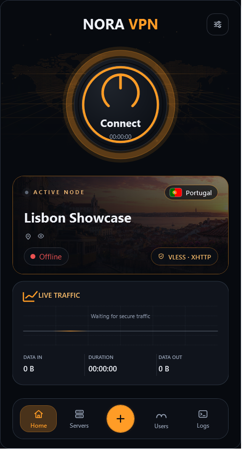
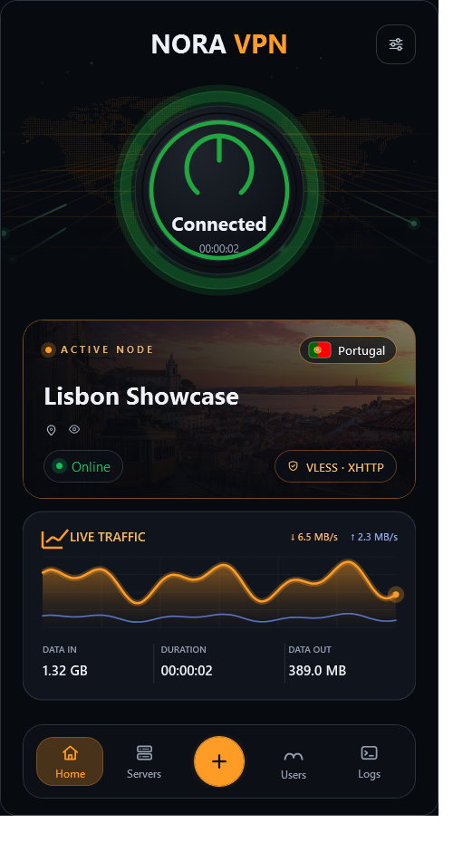
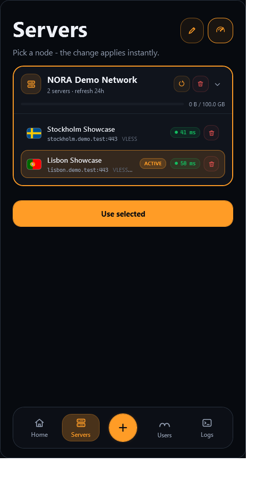

  

<h1 align="center">NORA VPN</h1>

  A visual Windows VPN client with flexible subscription imports and automatic refresh.

  
  
  
  

  
  
  
  

  <a href="#русская-версия">Русский</a> ·
  <a href="#english-version">English</a> ·
  <a href="docs/KROT.md">KRot</a>

<table>
  <tr>
    <td width="33.33%"></td>
    <td width="33.33%"></td>
    <td width="33.33%"></td>
  </tr>
</table>

## Русская версия

### Что это

**NORA VPN** — клиент для Windows 10 и 11 с понятным интерфейсом и поддержкой
подписок разных провайдеров. Добавьте подписку или свой сервер и подключитесь
одной кнопкой.

Живой главный экран, карта, фотографии локаций и плавный график трафика
помогают видеть состояние подключения.

### Что поддерживается

- **VLESS, VMess и Trojan** — ссылки подключения, HTTPS-подписки, Base64,
  Xray JSON и Clash YAML. Для VLESS доступны Reality, TLS и XHTTP.
- **AmneziaWG 2.0** — конфиги AmneziaWG и WireGuard-совместимого формата.
- **KRot / Крот** — экспериментальный протокол для своего VPN-сервера
  с управлением пользователями и учётом трафика.

### Возможности

- **Фото локаций.** Карточка сервера показывает фотографию страны или города.
- **Работа в трее.** NORA продолжает работать после закрытия окна.
- **Эквалайзер.** Реагирует на музыку и другие звуки компьютера.
- **Плавный Live Traffic.** График показывает изменения скорости без резких скачков.
- **Диагностика подключения.** На странице Logs можно проверить соединение
  и получить отчёт.
- **Автообновление подписок.** NORA обновляет подписки по расписанию и повторяет
  попытки при сбоях. Если обновление не удалось, рабочие настройки сохраняются.

### Пресеты маршрутизации

**Discord Mode** направляет через VPN только Discord. Остальные приложения
используют обычное подключение. Режим открывается кнопкой с иконкой компьютера
на главном экране и работает с VLESS и KRot; AmneziaWG пока не поддерживается.

Режим находится в бета-версии. Если переключение не удалось, NORA возвращает
прежние настройки и пытается восстановить подключение.

### Что такое KRot

**KRot** — экспериментальный протокол для своего сервера на VPS. Из NORA можно
установить узел, создавать пользователей и смотреть расход трафика.
Подробности — в [описании KRot](docs/KROT.md).

### Как начать

1. Скачайте [**Setup**](https://github.com/kevin-popins/NORA-VPN-DESKTOP/releases/download/0.1.0-pre.10/NORA-VPN-Setup-v0.1.0-pre.10-win-x64.exe) для установки или [**Portable**](https://github.com/kevin-popins/NORA-VPN-DESKTOP/releases/download/0.1.0-pre.10/NORA-VPN-Portable-v0.1.0-pre.10-win-x64.zip) для запуска без установки.
2. Запустите NORA VPN.
3. На странице **Add** добавьте подписку, конфиг или свой KRot-сервер.
4. Выберите сервер на странице **Servers** и нажмите Connect.

[Все релизы](https://github.com/kevin-popins/NORA-VPN-DESKTOP/releases) · [Сайт NORA](https://nora.rest/)

NORA VPN распространяется по [Apache License 2.0](LICENSE).
Название и логотип описаны в [правилах использования бренда](TRADEMARKS.md).
Сторонние проекты — в [NOTICE](NOTICE) и [THIRD_PARTY.md](docs/THIRD_PARTY.md).
Обновление и сохранение данных — в [документации установщика](docs/INSTALLER.md).

---

## English version

### What it is

**NORA VPN** is a Windows 10/11 client with clear controls and support for
subscriptions from different providers. Add a subscription or your own server
and connect with one button.

A live home screen, map, location photos and smooth traffic graph
keep the connection status in view.

### What it supports

- **VLESS, VMess and Trojan** — connection links, HTTPS subscriptions, Base64,
  Xray JSON and Clash YAML. VLESS supports Reality, TLS and XHTTP.
- **AmneziaWG 2.0** — AmneziaWG and WireGuard-compatible configuration files.
- **KRot** — an experimental protocol for your own VPN server,
  with user management and traffic tracking.

### Features

- **Location artwork.** The server card shows a country or city photo.
- **Tray behavior.** NORA keeps running after the window is closed.
- **Server selection.** Choosing a server opens Home immediately.
- **Equalizer.** Reacts to music and other sound playing on your computer.
- **Smooth Live Traffic.** The graph shows speed changes without abrupt jumps.
- **Connection diagnostics.** Run a connection check and get a report on Logs.
- **Automatic subscription refresh.** NORA refreshes subscriptions on schedule
  and retries after failures. Working settings are preserved if an update fails.

### Routing presets

**Discord Mode** sends only Discord through the VPN while other apps use the
normal connection. Open it with the computer icon on Home. It works with VLESS
and KRot; AmneziaWG is not supported yet.

The mode is in beta. If switching fails, NORA restores the previous settings
and attempts to restore the connection.

### What is KRot?

**KRot** is an experimental protocol for your own VPN server on a VPS.
Install a node, create users and view traffic usage from NORA.
Read the [KRot overview](docs/KROT.md) for more.

### Getting started

1. Download [**Setup**](https://github.com/kevin-popins/NORA-VPN-DESKTOP/releases/download/0.1.0-pre.10/NORA-VPN-Setup-v0.1.0-pre.10-win-x64.exe) for installation or [**Portable**](https://github.com/kevin-popins/NORA-VPN-DESKTOP/releases/download/0.1.0-pre.10/NORA-VPN-Portable-v0.1.0-pre.10-win-x64.zip) to run without installation.
2. Launch NORA VPN.
3. On **Add**, import a subscription or configuration, or add your KRot server.
4. Choose a server on **Servers** and press Connect.

[All releases](https://github.com/kevin-popins/NORA-VPN-DESKTOP/releases) · [NORA website](https://nora.rest/)

NORA VPN is available under the [Apache License 2.0](LICENSE).
The name and logo are covered by the [brand-use policy](TRADEMARKS.md).
Third-party projects are listed in [NOTICE](NOTICE) and [THIRD_PARTY.md](docs/THIRD_PARTY.md).
See [installer documentation](docs/INSTALLER.md) for upgrades and data preservation.
