# NORA VPN Windows installer

NORA ships as both a Windows Setup executable and a portable ZIP. Setup uses a
stable product identity so every later build updates the existing installation
instead of creating another Programs entry.

## Install and update behavior

- Program files are installed per-machine under `C:\Program Files\NORA VPN`
  by default. A different folder can be selected on first installation.
- The Start Menu shortcut is always created. The desktop shortcut is optional
  and enabled on first installation.
- Updates reuse the previous installation folder and shortcut choice.
- Downgrades are blocked by the monotonic four-part installer version.
- If NORA is running, interactive Setup explains that an active VPN must be
  disconnected, asks first, then uses NORA's graceful Exit path. It never uses
  force-kill. Silent setup refuses to stop a running VPN.
- Repair replaces installer-owned application files only.

## Data and Premium preservation

Durable state belongs to the Windows user and lives under
`%LOCALAPPDATA%\NORA VPN`. Setup never copies application payload files into
that directory and never reads, decrypts or regenerates `premium.dat`.

The preservation contract covers:

- `premium.dat` and `appearance.json`;
- `subscriptions\`, including provider data and custom order;
- `profiles\` and `external-profiles\`;
- `state.json` and the selected profile path;
- `ui-preferences.json` and the tray-notice choice;
- `discord-mode.json`, `managed-secrets.json` and pending installs.

Default uninstall removes binaries and shortcuts but keeps the entire user data
directory. Permanent data removal is a separate explicit confirmation; its
default button is **No**. A legacy user-owned `client-profile.json` beside the
executable is excluded from install/update ownership and preserved.

Premium state uses Windows DPAPI for the current user. Setup must be run for the
same Windows account; it does not migrate Premium activation between accounts.

## Legal material

Setup displays and installs the existing Apache License 2.0, usage/network
notices, `NOTICE`, `TRADEMARKS.md`, third-party notices and artwork attribution.
It does not invent a separate EULA, privacy policy or Terms of Use that are not
present in this repository.

## Build

Install Inno Setup 6.7 or later, provide the verified Windows runtime cores, then run:

```powershell
.\scripts\build-installer.ps1
```

The script publishes a self-contained win-x64 application, runs the portable
regression suite, generates the branded wizard artwork, compiles Setup and
compares the Setup icon pixels with the canonical `assets/logo.ico`.

## Isolated verification

For a host that already runs NORA, use the explicit `Isolated` verification mode
on both packaging scripts. Supply a matching `ManagedTestDll`, a private
`ProofDirectory` outside source/payload folders, and the existing approved
`ApprovedCoreBundle` ZIP. Isolated mode uses restored dependencies, never fetches
cores, and compares every staged core against that ZIP without executing it.

Wait for the build to finish successfully before copying its DLL, runtime
companions and assets to an immutable QA stage. Keep one build/test runner per
checkout. `Isolated` verifies the staged executable version and commit, hashes
its embedded managed assembly against the tested DLL, checks branding and all
shipping assets, then runs a fixed serialized set of early managed self-tests
with separate fixture roots. It does not invoke the normal shell, installer,
installed app, single-instance activation or core executables. Private evidence
records actual hashes, versions and test exits. Full verification retains the
historical executable/core tests and belongs on a separate test machine.

Application and installer version defaults come from the project. Overrides are
passed to compilation and checked before Setup is built; changing a Setup label
alone cannot relabel an older application payload. Install/update execution is
a separate lifecycle check, not implied by successful package verification.

See [subscription behavior](SUBSCRIPTIONS.md) for metadata, recovery and display
restrictions.

## Visual states

| Welcome | License | Data/network notices |
|---|---|---|
| 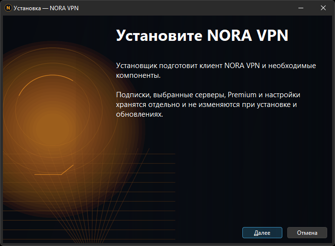 | 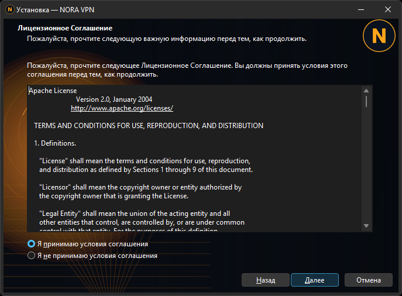 | 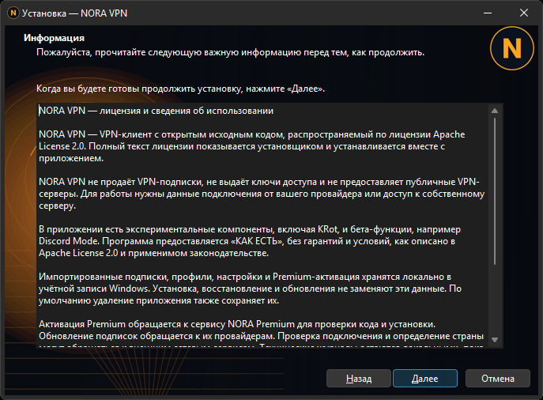 |

| Folder | Desktop shortcut | Ready |
|---|---|---|
| 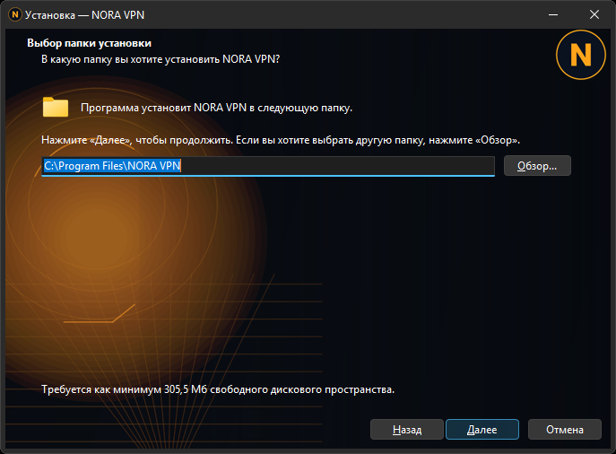 | 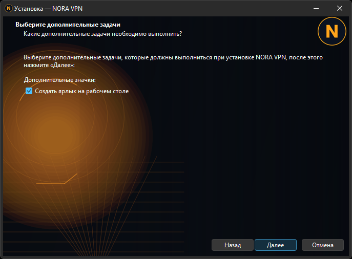 | 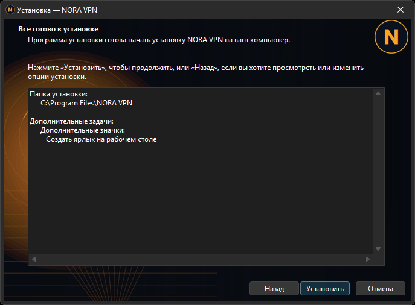 |

| Update | Safe running-app warning | Progress |
|---|---|---|
| 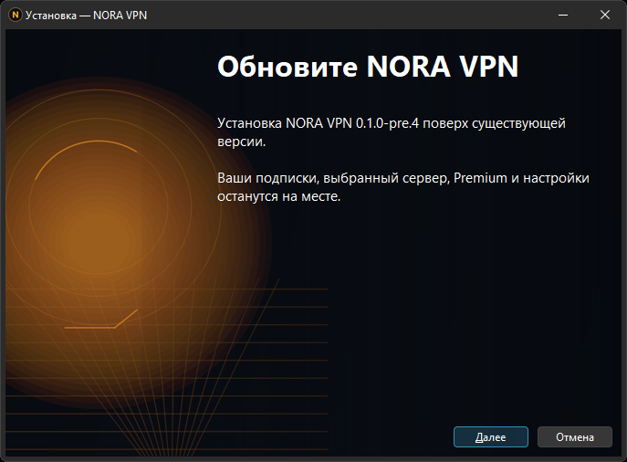 | 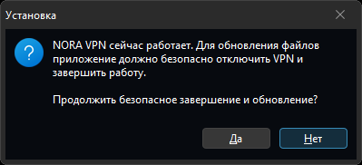 | 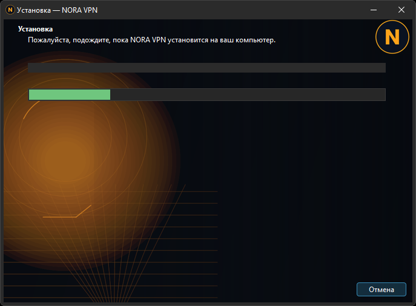 |

| Success | Explicit data removal |
|---|---|
| 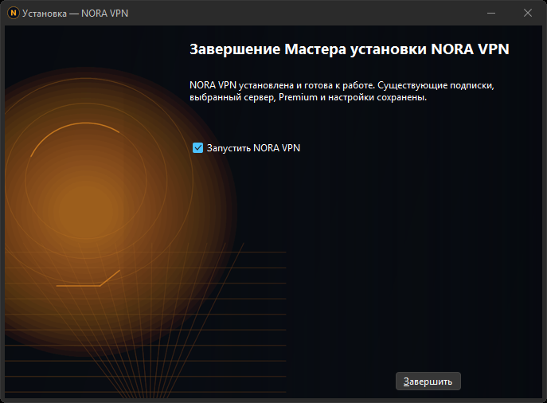 | 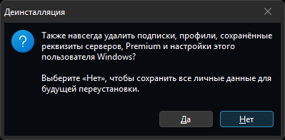 |

The screenshot build uses a separate Visual-QA product ID and user-writable QA
folder. It does not install over or stop the user's real NORA instance.
